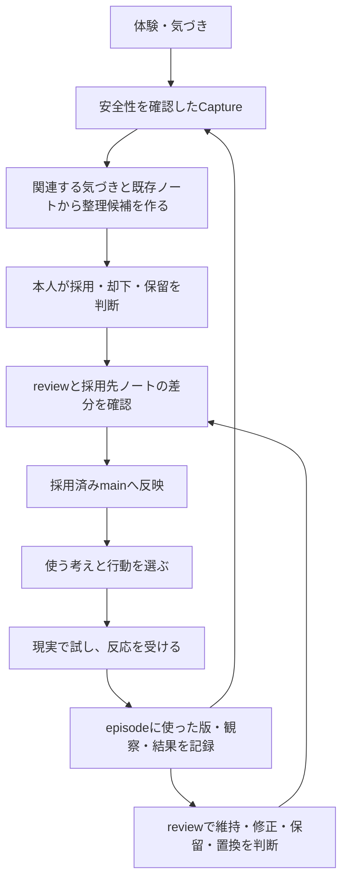

# 体験の時間・気づきの整理・試した結果をつなぐ設計

体験した時期・気づきの整理・実施結果のフィードバックループを扱う設計書です。  
核心は **「出来事の時期を記録の履歴から分け、整理の判断を review に残し、試した結果を episode から考えの更新へ返す」** の 3 点です。

- 実装状態：課題 1〜3 は任意属性・検証・閲覧 API・GUI・ローカル CLI として実装済み（正本スキーマは [SCHEMA.md](../SCHEMA.md)、実手順は [experience-feedback-workflow.md](experience-feedback-workflow.md)）。
- 対象外：既存ノートの自動移行や原則の自動採用は行いません。安全チェックは [DATA_POLICY.md](../DATA_POLICY.md) と [記録前の安全チェック](privacy-ingress.md) を全段階の前提とし、見方の変化の自動検出は別設計とします。
- 以下の使用例はすべて架空です。

---

## 全体像：何を追加し、何を変えないか

**新しい正本 type やフォルダは増やしません。** 既存の Markdown・Git 履歴・review・episode を任意属性で拡張します。

| 課題 | 既存の仕組み | 追加したもの |
| --- | --- | --- |
| **1. 時間を分ける** | `created` / `updated`、本人確認日、SHA 復元、first-parent 順 | 精度付きの体験・気づき・採用の時期（`temporal`）と、体験時期での一覧閲覧 |
| **2. 気づきを整理する** | Capture Issue、PR 採用、review | 整理候補、提案への判断（`consolidation`）、Capture ごとの結果（`capture_outcomes`） |
| **3. 試して結果を戻す** | episode、`maturity`、review、由来と置換参照 | 使ったノートの版と結果（`application`）、成熟度変更の根拠（`maturity_changes`） |



- すべての Capture が原則まで昇格する必要はありません（保存しない・保留する判断も完結した判断）。
- 「採用済み main へ反映」はリポジトリへの採用であり、本人がいつ信じたかや行動した証拠とは別です。
- 検証は [`schema.py`](../src/self_observatory/schema.py)（単体属性・組合せ）と `validate-feedback`（Git 横断整合・成熟度変更根拠）で行います。[`review_queue.py`](../scripts/review_queue.py) は Notion 未確認と期限超過専用であり、Capture 待ちと混ぜません。

---

## 課題 1：体験・気づき・記録・採用の時期を分ける

### `temporal` 属性の定義

ノートの主たる出来事・気づき・考えの採用について、**精度を保った暦上の時期**を任意属性 `temporal` に記録します。

| 属性 | 意味 | 代用・推定に使わないもの |
| --- | --- | --- |
| `temporal.experienced` | 体験した時期 | ノート作成日、commit 時刻 |
| `temporal.noticed` | 意味に気づいた時期 | AI の提案生成日時 |
| `temporal.adopted` | 考えを自分のものとして採用した時期 | PR マージ日時、`status: active` |
| 既存 `created` / `updated` | 正本の作成日 / 意味上の更新日 | 出来事の時期の代用 |
| 既存 `review.confirmed_at` | 直近の明示確認日 | 最初の採用時期の代用 |

> Issue 作成日時は入口への記録日時、Git 初出 SHA は履歴への登場として別に表示します。

```yaml
# 任意属性の例（日付文字列は引用する）
temporal:
  experienced: {precision: year, value: "2018"}
  noticed: {precision: month, value: "2026-08"}
  adopted: {precision: unknown}
```

### 精度（`precision`）の契約

省略は「未記録」、`unknown` は「不明と明示」を表し、どちらも別の日付で補完しません。

| `precision` | 正本の値 | 表示例 |
| --- | --- | --- |
| `year` | `value: "YYYY"` | 2018年 |
| `month` | `value: "YYYY-MM"` | 2018年4月 |
| `date` | `value: "YYYY-MM-DD"` | 2018年4月12日 |
| `range` | `start` と `end` に `year` / `month` / `date` を 1 つずつ | 2018年4月〜6月 |
| `unknown` | 値なし | 時期不明 |

- `range` の例：`{precision: range, start: {precision: month, value: "2018-04"}, end: {precision: month, value: "2018-06"}}`（端点省略・`unknown`・入れ子 `range` は不可。曖昧な説明は本文へ）。
- **検索の扱い**：年・月は半開区間（例：2018 年 ＝ 2018-01-01 以上 2019-01-01 未満）として扱い、区間が重なる記録の先後は断定せず同じ候補帯に並べます。
- **検証**：実在暦日・精度と値の一致・開始下限 < 終了上限を検証します。4 つの時期の大小関係は必須条件にせず、疑わしい順序は診断で提示します。
- 複数の独立した体験は同じ欄を上書きせず、別 episode に分けて参照します。

### 2 つの時間ビュー（選択 SHA を共有）

- **「記録の歴史」**：従来の Trajectory / Self Time Machine / Self Time Volume を継承。SHA と first-parent 順が基準（Volume の Z 軸も Git 採用順のまま）。
- **「体験の時期で見る」**：選択 SHA に存在するノートだけを `temporal.experienced` 順に並べる一覧。不明・未記録は末尾の別欄に残して隠しません。
  - 例：2018 年の体験を 2026 年 9 月に初記録した場合、記録後の SHA では 2018 年の帯に出ますが、記録前の SHA には登場しません（「2018 年当時の本人の考え」とは表示しない）。
  - `review_after` の期限判定には体験時期を使いません。

---

## 課題 2：提案への判断と Capture の整理結果を記録する

### 整理候補（`_local/`）

- 初期版は、本人が対象 Capture を選び、既存ノート（タグ・明示参照・語句検索）を確認して整理候補を作ります（クラスタリング基盤は不要）。
- 各候補は `proposal_id`・対象 Capture 参照・取得日時と入力ハッシュ・`base_sha`・採用先候補 ID・Markdown 差分を持ち、`_local/` に置きます（正本件数や確認済み関係には含めない）。
- 本文では「共通構造」「相違点・反例」「未確認点」「置き場所の理由」を明示します。
- 同じ出来事の複数 Capture を独立した反復証拠として数えません。すべてを Pattern 経由にせず、意味に応じて既存 type を選びます。
- 候補作成後に `main` や入力 Issue が変わったら再生成・再確認が必要で、古い `accept` は流用しません。

### review の 2 つの記録：`consolidation` と `capture_outcomes`

**「案を却下すること」と「元の気づきを破棄すること」を明確に分けます。**  
1 回の判断を 1 つの `type: review` に記録します。

```yaml
# review の共通 frontmatter に追加する属性の例（番号・ID は架空）
consolidation:
  proposal_id: proposal-example-organization
  decision: accept
  capture_refs: [github-issue-101, github-issue-102]
  target_ids: [pattern-example-preparation]
capture_outcomes:
  - ref: github-issue-101
    outcome: canonicalized
    note_ids: [pattern-example-preparation]
  - ref: github-issue-102
    outcome: deferred
    note_ids: []
review:
  owner_confirmed: true
  confirmed_at: "2026-09-27"
```

| 本人の操作 | `consolidation.decision` | `capture_outcomes` |
| --- | --- | --- |
| この案を採用する | `accept` | 正本化したものだけ `canonicalized`。残りは個別指定 |
| このまとめ方を却下する | `reject` | 原則変更なし（別案や個別記録として残せる） |
| この案の判断を延期する | `defer` | 提案のみの保留か、Capture 自体の `deferred` かを選択 |
| この Capture は保存しない | 省略可 | `discarded`（安全な短い理由のみ残す） |

#### 整合ルール

- `consolidation` がある場合は 4 属性必須。`accept` 時は採用先 ID と `canonicalized` 結果が各 1 件以上必要。`reject` / `defer` 時は `target_ids` を空にします。
- `capture_outcomes` の `ref` は 1 つの review 内で重複不可。`consolidation` 併記時は `capture_refs` 内に限定し、`canonicalized` の `note_ids` 集合と `target_ids` を一致させます。`discarded` / `deferred` の `note_ids` は空。
- `accept` した案は、review と採用先ノートを **同じ PR** に含めます。マージ前は「反映待ち」、採用済み SHA で両方確認できて初めて「正本化済み」になります。
- review の本人確認はこの判断記録に対する確認であり、採用先ノート全内容の確認を自動代行しません。

### 整理状況の導出（Git から計算）

| 状態 | 根拠 |
| --- | --- |
| **未整理** | 選択 SHA に有効な整理結果がない |
| **保留** | 最新の明示結果が `deferred` |
| **正本化済み** | 最新の明示結果が `canonicalized` かつ採用先を解決できる（後日削除時は「正本化済み（採用先削除）」） |
| **破棄** | 最新の明示結果が `discarded` |
| **確認が必要** | 結果が衝突・採用先欠落などで確定できない |

- 有効な整理結果は、選択 SHA に存在する `status: active` かつ `review.owner_confirmed: true` の review から導きます。
- 「最新」は日付の大小ではなく **選択 SHA までの first-parent 採用順** です。判断を変えるときは新しい review から旧 review ID を `supersedes` し、旧 review を `superseded` にします（一部変更時は変更しない結果も引き継ぐ。未接続の衝突は「確認が必要」）。
- GitHub の open / closed やラベルは別欄表示とし、close だけで正本化済み・破棄にしません。未取得を「未整理 0 件」にせず、取得日時・対象範囲・部分取得を示します。

---

## 課題 3：実施済みの episode に使った版と結果を残す

### 予定と実施記録の分離（`application`）

- **実施前**：Issue または `_local/` に仮説と予定を置く。
- **実施後**：`memory/episodes/` に記録し、episode 専用の任意属性 `application` に「使ったノートの版（ID + 完全な commit SHA）」と「結果」を残す（新しい Application / Experiment 型は作らない）。

```yaml
# 実施済み episode の任意属性例
temporal:
  experienced: {precision: date, value: "2026-09-26"}
application:
  targets:
    - note_id: playbook-example-prepare
      at: "<実際に使った内容を含む完全なcommit SHA>"
  outcome: inconclusive
```

- `targets` は非空・重複なし。指定 SHA の tree に ID が存在することを検証します（不明な過去実施は `at: null` を明示し、現行 head で穴埋めしない）。
- 本文は「仮説・確かめたいこと」「行動と適用条件」「観察した反応」「結果の解釈」「不確実性」「次に変えること」に分けて書きます。
- 複数ノートを同時使用した結果は試行全体の結果であり、個別ノートの効き目へ配分しません。
- 反応待ち（`pending`）が後から判明したら **同じ episode を更新** し、再試行は **別 episode** にします。

| `application.outcome` | 表示 | 意味 |
| --- | --- | --- |
| `success` | 成功 | この条件で目的に沿う結果を観察した |
| `failure` | 失敗 | この条件で目的に反する結果を観察した |
| `no_effect` | 効果なし | 観察範囲で期待した変化がなかった |
| `inconclusive` | 判断不能 | 観察不足・条件不成立・他要因などで判定できない |
| `pending` | 結果待ち | 行動は実施済みで、反応確認待ち |

### 結果から考え・成熟度を更新する（`maturity_changes`）

成熟度（`maturity`）を変えるときは、`type: review` に任意属性 `maturity_changes` を記録し、対象ノートの変更と **同じ PR** で審議します。

```yaml
maturity_changes:
  - note_id: playbook-example-prepare
    from: observed
    to: tested
    evidence_ids: [episode-example-try-prepare]
```

| 変更先 | 本人が確認する根拠 |
| --- | --- |
| `observed` | 複数の観察、または強い 1 回の観察とその限界 |
| `tested` | 意図した実施と結果評価がある episode（`pending` のみでは不足） |
| `stable` | 複数条件で繰り返し役立った根拠と、反例・適用外条件 |

- `tested` は「成功した」という意味ではありません（失敗・効果なし・判断不能も評価済み証拠になる）。回数だけで `stable` にせず、格下げ・条件限定・supersession も選びます。
- 検証は PR / 採用時差分で `from`（変更前）と `to`（変更後）の一致、および `evidence_ids` の存在を確認します。証拠 episode は review 採用 SHA の tree から読むため、同一 PR で episode を追加する場合も成立します。
- **`application.targets` は `derived_from` に自動変換しません**。「原則版 A → 実施 episode B → 更新版 C」を版付きで辿ることで、由来グラフの循環を防ぎます。
- 行動回数や成功率を人物の価値やランキングに変換しません。未記録を未実施と判定しません。

---

## 実装分担・互換性・完了条件

### コンポーネントごとの役割

| 場所 | 担当 |
| --- | --- |
| `SCHEMA.md` / `schema.py` / `templates/` | `temporal`・`consolidation`・`capture_outcomes`・`application`・`maturity_changes` の正式化と検証 |
| `index.py` | tree からの時期・判断・実施記録の派生索引（index v7 / parser v3） |
| `models.py` / `api.py` | 閲覧専用の 3 API（`/api/experiences`・`/api/captures`・`/api/applications`） |
| `cli.py` 等 | 候補生成・鮮度確認・整合検証・索引再構築 |
| `apps/observatory/src/` | 「体験の時期」「気づきの整理」「試した記録」の 3 画面（デザイン原則準拠、状態は色だけに頼らず文字で表示） |

### 後方互換ルール

- 旧ノートに新属性は必須にしません（既存の `tested` / `stable` を取り消さず「根拠未構造化」「時期未記録」として表示）。
- 新たな常駐ジョブ・クラスタリング DB・GUI からの直接書き込みは導入しません。
- 構造化のための正本編集は既存規則上 Self 側に現れますが、「本人が変わった」とは説明しません。

### 実装ステップと受け入れ条件

| 順序 | 対象 | 完了条件 |
| --- | --- | --- |
| 1 | 時期スキーマ・検証・詳細欄・体験時期一覧 | 精度と不明を保持し、後記録の過去が以前の SHA に混入しない |
| 2 | review 整理判断・結果・参照検証・手動候補手順 | 採用先と review を同時確認でき、`reject`/`discarded`・close/`canonicalized` を区別できる |
| 3 | 明示的 Capture 取得・整理状況一覧・関連候補 | 取得範囲・未取得を表示し、入力変更後の古い案を拒否する |
| 4 | episode 実施記録・`maturity_changes`・逆引き | 「使った版 → 結果 → 採用変更」を辿れる |

#### 主な受け入れケース

- 年・月・日・範囲・不明・省略・閏日・逆転範囲の検証と非補完
- 2018 年体験を 2026 年追加した際の、前後 SHA での見え方の分離
- 候補 `accept` 後に `base` や入力が変わった場合の拒否
- 提案 `reject`、Issue の open/closed/reopened、一部採用、保留後の再判断、衝突 review の「確認が必要」判定
- PR 未マージ（反映待ち）・マージ済み（正本化）・後日削除（採用先削除）の区別
- GitHub 未接続・部分取得・本文編集で未取得を 0 件や過去本文に見せないこと
- 失敗・効果なし・判断不能・結果待ち・`at: null` の保持、および使用参照と由来参照の分離
- 旧ノート・旧 review CLI・索引削除再構築の再現性維持

> `SCHEMA.md` の規則は [データ契約 §6](self-observatory-data-contracts.md#6-memory-metabolism--weather--constellation) の `capture_outcomes` 案を統合したものです。課題 4・5 が残るため、本設計のみで親 Issue #39 全体は完了としません。
