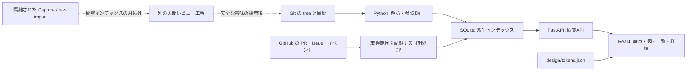

# Self Observatory 実装設計案

Git の特定コミットからノートと関係を復元し、「時点・ノート・比較先」を全画面で共有するローカル閲覧アプリの設計書です。  
最初の完成目標は、実データを使って **「いつ変わったか」「なぜこの記録があるか」「何を再確認するか」** を自在に往復できる状態です。

> 本書は実装計画の設計文書であり、現行スキーマや本人の原則を直接変更するものではありません。

- ビジョン：[Self Observatory GUI ビジョン](self-observatory.md)
- 詳細データ契約：[self-observatory-data-contracts.md](self-observatory-data-contracts.md)

---

## 1. 設計時点のリポジトリ状況（2026-09-24 調査）

本設計は、ローカル Git リポジトリの `main` / `origin/main` 採用履歴を対象とした閲覧専用アプリを前提としています。

| 項目 | 設計時点の状態 | 設計への反映 |
| --- | --- | --- |
| 正本ノート | 40 件（Influence 31 / Episode 1 / Principle 1 / Playbook 4 / Decision 3） | この規模で動く閲覧版から作る。未作成の型は 0 件表示 |
| 状態（`status`） | `active` 21 / `draft` 19 | `draft` を失敗や不要として扱わない |
| 本人確認 | `true` 17 / 未記録 23 / 明示 `false` 0 | 未記録と `false` を明確に分ける |
| 既存レビュー一覧 | 未確認 Notion import 19 / 期限超過 active 0（2026-09-24 基準） | 既存 CLI（`scripts/review_queue.py`）と条件を統一する |
| 明示的参照 | `related` 4 / `derived_from` 1 / supersession 0（欠落なし） | 本文から勝手に補完しない |
| Git 履歴 | 55 コミット（記録日は 2026-09-23 に集中） | 月単位の偽の軌跡を作らず、コミット単位から始める |
| 検証・パーサ | 既存 Python スクリプトあり。ただし関係配列の本格解析は未対応 | GUI の前に共通パーサと ID 参照検証を整備する |
| 緊張・反例・Capture 結果 | 構造化スキーマなし | 記録方式を先に定義してから表示を拡張する |

> `scripts/review_queue.py --as-of` は現行ファイルへの期限計算であり、過去スナップショットの復元機能ではありません。

---

## 2. システム構成と技術選定



### 採用技術

| 領域 | 採用技術 | 選定理由 |
| --- | --- | --- |
| ブラウザ UI | React + TypeScript + Vite（pnpm） | 時点・選択・比較の連動を型安全に扱う。SSR や公開サイトは初期要件外 |
| 図の描画 | SVG + React | 現状規模なら専用グラフ DB や WebGL なしで軽量に操作できる |
| API / 解析 | Python + FastAPI + Uvicorn | 既存の Python 検証・レビュー条件を共有し、TS 側で二重実装しない |
| YAML 解析 | PyYAML（安全読込＋重複キー拒否＋厳格な型検証） | 関係配列や新構造を独自文字列パーサで増築しない |
| 派生保存 | Python 標準 `sqlite3` + Git CLI | 単一ユーザー・ローカルで完結し、削除しても再構築できる |
| Markdown 表示 | React 用 Markdown renderer（raw HTML 無効） | 本文のスクリプト実行や外部埋め込みを防ぐ |
| テスト | Python 契約テスト + Playwright | 過去分離と意味の保存を確実に検証する |

参考公式資料：[Vite](https://vite.dev/guide/) / [FastAPI Static Files](https://fastapi.tiangolo.com/tutorial/static-files/) / [Python sqlite3](https://docs.python.org/3/library/sqlite3.html)

### 依存と構成の方針

- **MVP に含めないもの**：Graphiti、ベクトル DB、クラウド、ログイン基盤、常駐ジョブ。まず明示的参照だけで問いに答えられるかを検証します。
- **配信方法**：通常利用はビルド済み UI と API を同じローカルサーバーから配信し、開発時のみ Vite から API へ proxy します。
- **パッケージ管理**：Python は `pyproject.toml` + `uv.lock`、JS は `package.json` + `pnpm-lock.yaml` でそれぞれ管理します。
- **既存 CLI の互換**：`scripts/validate_frontmatter.py` と `scripts/review_queue.py` の入口・JSON 出力を維持し、共通ロジックを呼ぶ形に移行します。

### ディレクトリ配置

```text
pyproject.toml / uv.lock             Python 依存と CLI
package.json / pnpm-lock.yaml        UI 開発・ビルドの入口
src/self_observatory/
  schema.py                          共通の解析・検証
  git_reader.py                      checkout せず tree と履歴を読む
  index.py                           SQLite を生成・更新
  queries.py                         時点・由来・差分・レビューの検索
  api.py / cli.py                    閲覧 API とローカル操作
  github_sync.py                     正規化済み外部記録の取り込み（後続）
apps/observatory/                    React アプリ
tests/                               架空の小さな Git 履歴と画面テスト
scripts/                             既存 CLI（共通ロジックの入口）
.derived/self-observatory/           SQLite 等（gitignore 対象）
_local/                              Capture・raw import（検索対象外）
```

> 正本フォルダは移動しません。アプリコードや `docs/`・`design/` の変更は、自己モデルの変化数に含めません。

---

## 3. 共通の画面構成と操作設計

10 枚の独立ページを並べるより、**すべての画面で「選択コミット・選択ノート・比較コミット・フィルター」を共有する**ことを優先します。ノートを選んだまま Provenance → Self Diff へシームレスに移動できます。

```text
上部   リポジトリ / 採用済み main の取得状況 / 選択日時・SHA / 検索
左側   Overview / Trajectory / Provenance / Self Diff / Review Radar
中央   グラフ・タイムライン・一覧の切替
右側   選択ノートの本文・属性・根拠・変更履歴・GitHub リンク
下部   コミット選択と前後移動（履歴画面）
```

### 操作の約束事

- **URL での状態共有**：`/provenance?at=<sha>&note=<id>`、`/diff?from=<sha>&to=<sha>&note=<id>` のように完全な SHA を保持します（`HEAD` のような可変 ref は SHA に解決して共有）。
- **存在しない時点の扱い**：時点を動かしてノートが存在しなくなった場合は「この時点には記録がありません」と表示し、最新本文へ差し替えません。
- **競合防止**：時点切替時に古いレスポンスは破棄し、異なる SHA の情報が 1 画面に混ざらないようにします。
- **グラフの初期範囲**：選択ノートの前後 2 段を表示し、展開・全体表示に切り替えられます。未接続ノートも一覧に必ず出します。
- **アクセシビリティ**：デスクトップは 3 ペイン、狭い画面は詳細を別ペイン切替。ドラッグに依存せず、キーボード・前後ボタン・一覧で全機能に到達できます。
- **段階的なメニュー追加**：Parallel Selves や Contradictions は実装後に追加し、未実装メニューで初期サイドバーを埋めません。

---

## 4. モック 10 枚とデータ要件の対応

| モック | 実装する挙動 | 根拠・制約 |
| --- | --- | --- |
| `overview.webp` | 選択時点の件数・最近の正本変更・レビュー候補・選択ノートの由来 | 件数クリックで型別一覧へ移動。モックの架空件数は使わない |
| `provenance-genealogy.webp` | `derived_from` を遡り、`related` を別線で表示。本文・source・初出コミットを確認 | Influence の保存を原則への全面支持と同一視しない |
| `self-time-machine.webp` | first-parent 上の採用済みコミットを選び、全画面を同じ tree に切替 | Git に存在しない過去は選べない。出来事の日付を遡及的知識にしない |
| `belief-diff.webp` | 同一 ID の追加・削除・本文・status・review・参照の前後差分 | 「人格が成長した」等の解釈は自動生成しない |
| `fading-memory-review-decay.webp` | 本人確認（true / false / 未記録）と `review_after` に基づく予定・超過 | 「61 日で劣化」のような一律ルールは使わない |
| `parallel-selves.webp` | モデル変更 PR の提案差分・採否・実際の main との差 | GitHub 同期が必要。閉じた理由や仮想人生は創作しない |
| `contradiction-map.webp` | 確認済み緊張関係の条件・根拠・関連判断を表示 | 関係記録スキーマが必要。未記録を「矛盾なし」とみなさない |
| `memory-metabolism.webp` | 明示的な出典・派生・置換の経路と退出 | Capture 結果・Action/Review 記録が必要。在庫比を転換率にしない |
| `memory-weather.webp` | 期間内の変更・未確認・期限・緊張関係を領域別に表示 | 算式と対象ノートを開示。気分や健康状態を推測しない |
| `life-constellation.webp` | ノートと参照を空間配置で探索・任意再生 | 最初は明示的関係で配置。類似度導入時は凡例を明示 |

### デザイン原則の適用ルール

- [design/tokens.json](../design/tokens.json) を CSS 変数へ変換して使用します。
  - 背景：Cream / 本文：Ink / 補助線：Charcoal / 選択：Yellow / 緊張・注意：Blush（Yellow / Blush 上の文字は Ink）。
  - フォント：Helvetica Neue スタックを継承。
- **モックから採用しない要素**：多数の型別パステル色、青い選択色、霧のグラデーション、発光、装飾的な地形。
- **識別手段**：型は「形・アイコン・文字」、関係は「実線・破線・矢印」で表します。減衰表現は輪郭やバッジで示し、本文のコントラストを落としません。
- **動きの抑制**：時系列再生は任意操作とし、`prefers-reduced-motion` では即時切替。ノード配置は ID ごとに安定させ、時点移動で画面全体が踊らないようにします。

---

## 5. 履歴・差分・レビュー・外部同期の原則

### 採用済み `main` と時間の区別

- 通常の「現在」は設定された採用済み `main` の SHA です（作業ブランチ HEAD ではない）。接続先はリポジトリ名だけでなく GitHub repository ID でも照合します。
- Git tree を直接読むため、過去表示のために checkout や worktree 切替は行いません。
- **3 つの時間を混ぜない**：`created`（ノートの記録日）、Git 初出（リポジトリへの登場）、本文の出来事日付。
- Trajectory は first-parent 順で並べ、復元の鍵は常に SHA です（Git 日時だけからは厳密な到達時刻を保証しないため「Git 記録時点」と表記。[Git rev-list](https://git-scm.com/docs/git-rev-list)）。

### 差分・由来・確認状態

- **同一 ID 追跡**：パスが変わっても同じ ID なら改名・移動として追跡します。削除・`archived`・`superseded`・本文修正は明確に分けます。
- **明示的関係のみ**：文章の類似・日付の近さ・共通タグだけで因果の線を引きません。
- **確認状態と期限の分離**：`review` の `true` / `false` / 未記録を保持します。期限超過は `status == active && review_after < 基準日`（当日は超過ではない）。期限超過で `status`・`maturity`・確認値を自動変更しません。
- **確認後の本文変更**：本文変更後に確認情報が残る場合は「最終確認後の本文変更」と補足表示し、確認記録を勝手に消しません。

### GitHub 同期と追加の意味記録

- **同期方式（初期）**：Codex 上の GitHub プラグイン等で最小化した結果をローカルへ渡します（プラグインにない操作のみ `gh` で補助）。
- **欠落の誠実な表示**：未接続を 0 件にしない。部分取得は部分表示。現在のタイトルや本文を過去画面に混ぜない。
- **Parallel Selves の優先度**：正本や意味関係を変える PR を優先し、CI・モック・コード保守のみの PR は別フィルターに分けます。
- **追加スキーマ案（[データ契約](self-observatory-data-contracts.md)）**：
  - 緊張関係・反例：`relations/*.md`（根拠・適用条件・本人確認）
  - Capture 結果：既存 `review` ノートに記録（Issue close だけで破棄扱いしない）
  - 消えうる判断理由：必要なものだけ最小化して `decision` / `review` へ人間が採用

---

## 6. ローカル運用とセキュリティ境界

- **ネットワーク**：API は `127.0.0.1` のみにバインドし、Host / Origin を許可リストで検証。初期版は閲覧専用（更新・同期は CLI）。
- **許可リスト方式**：`_local/`、`.quarantine/`、raw import、`.env` は誤って Git に入っていても取り込みません。
- **メディア・HTML 保護**：raw HTML 無効、外部画像・iframe の自動読込禁止。メディアは該当 tree の承認済み asset だけ配信。
- **ローカル保護**：派生 SQLite は gitignore 下で私的情報と同等に保護。本文・秘密はログやテレメトリに出さず、認証情報は Git・ブラウザへ渡しません。
- **オフライン継続**：GitHub に接続できなくてもローカル正本の閲覧は継続できます。
- **公開の分離**：public サイトやリモート配信は別設計とし、private repo 自体を公開手段にしません。

---

## 7. 段階的リリース計画と受け入れ検証

### 実装ステップ（最初に作るのは 0〜2 の MVP）

| 段階 | 作るもの | 完了条件 |
| --- | --- | --- |
| **0. 基盤整備** | リポジトリ確認、共通 YAML パーサ、ID・参照・日付検証、`journals`/`reviews` 含む対象統一 | 既存 40 ノートと review CLI の挙動を維持。重複 ID や参照欠落を診断可能 |
| **1. 現在を読む** | Git tree reader、SQLite、閲覧 API、Overview / Browse / 詳細 / Review Radar、Tokens | `main` 実データから本文・確認状態・件数を表示。正本への書き込みゼロ |
| **2. 過去と由来（MVP）** | first-parent 履歴、Provenance、Trajectory、Self Diff、状態共有 URL | 過去 tree だけで表示し、同一 ID 追跡と前後差分を確認できる |
| **3. PR 比較** | GitHub 同期契約、取得範囲、Parallel Selves、Issue 導線 | merge / squash / rebase / 未採用 / 再 open / head 欠落を区別し、新情報を過去に混ぜない |
| **4. 緊張と変換** | `relations` スキーマ、緊張表示、Capture 結果、Metabolism | 採用済みの実例で根拠・条件・退出を辿れる（実例ゼロでも成立） |
| **5. 補助ビュー** | Weather、Constellation、任意再生 | 図から元ノートと計算根拠へ戻れ、データ不足を誇張しない |
| **6. 提案支援** | Capture 候補・関係候補・review 更新案・履歴限定 AI | privacy gate → 人間確認 → PR が成立。自動採用なし |

### 受け入れチェックリスト

- [ ] 実データで Review Radar が既存 CLI（19 件 / 0 件）と一致し、架空 fixture 数値を出さない
- [ ] 追加・変更・改名・削除・置換・merge を含む架空履歴で、選択 SHA の tree と全画面が一致し、作業ツリーが変わらない
- [ ] 過去時点から検索・由来・比較・メディアを開いたとき、未来の本文・関係・確認・asset が混入しない
- [ ] `true` / `false` / 未記録と、期日前日・当日・翌日が正しく区別され、`status` / `maturity` が不変である
- [ ] GitHub 未接続・部分取得・head 欠落を 0 件や完全復元に見せず、取得範囲を表示する
- [ ] `.derived` 削除後の再構築で、同じ Git 入力・parser 版から同じ正本投影が再現される
- [ ] キーボード操作と画面幅変更でも全情報に到達でき、時点・選択が失われない
- [ ] 隔離パス・raw HTML・外部画像・パストラバーサルが境界を越えない

### 性能の暫定目標

- 40 ノート規模で、キャッシュ済みクエリ **p95 ≤ 200 ms**、時点切替 **≤ 1 秒**。
- 1,000 ノートの架空履歴でも測定し、必要な箇所だけ索引・遅延読込を追加します。

---

## 8. 実装時に改めて決める範囲

- 本設計は **単一所有者・ローカルブラウザ・採用済み `main`** を前提とします（リモート常時利用・複数リポジトリ・共同編集は別設計）。
- 関係スキーマは段階 4 でレビュー・採用します。
- 段階 6 で AI 要約や「過去の自己との対話」を追加する場合は、送信先と利用範囲を事前に確定し、選択 SHA のノートだけを入力とした「その時点の記録からの再構成」と明記します。
- 本設計のデータ源はリポジトリ内の仕様・構造・最小集計（`SELF_PRIVATE`）と公式技術文書（`PUBLIC`）です。生の会話・業務資料・第三者識別情報は含みません。
